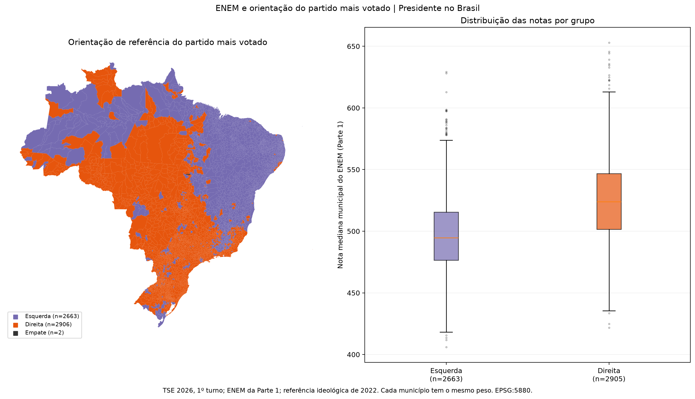
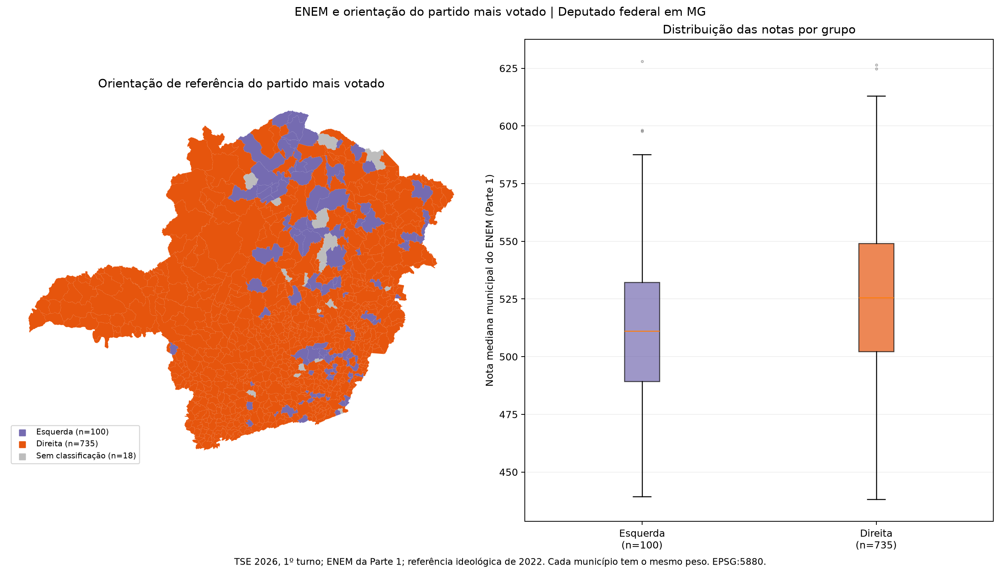

# Análise extra adicional: ENEM e orientação do partido mais votado

**Pergunta:** a nota mediana municipal do ENEM difere entre municípios onde o partido mais votado é classificado à esquerda ou à direita?

Esta análise foi acrescentada; o agrupamento anterior por homicídios e ENEM continua disponível.

## Como foi feita

- Presidente no Brasil: partido do candidato mais votado em cada município, no primeiro turno.
- Deputado federal em MG: partido com mais votos nominais e de legenda somados em cada município. Isso não significa que o partido conquistou uma cadeira nesse município.
- A nota vem de `ips_nota_mediana_enem`, da Parte 1, ligada pelo código IBGE.
- Cada município tem o mesmo peso. Comparamos as distribuições e a mediana das notas medianas municipais; não é a mediana de todos os estudantes desses municípios.
- Empates, partidos sem classificação e notas ausentes ficam identificados e fora da comparação entre grupos.

## Resultados

| Escopo | Municípios de esquerda com ENEM | Municípios de direita com ENEM | Mediana do grupo de esquerda | Mediana do grupo de direita | Diferença: direita − esquerda |
|---|---:|---:|---:|---:|---:|
| Presidente no Brasil | 2663 | 2905 | 494.78 | 523.94 | +29.16 |
| Deputado federal em MG | 100 | 735 | 511.13 | 525.62 | +14.49 |

As diferenças são descritivas. Não foi aplicado teste de significância nem controle por renda, região ou dependência espacial. Não demonstram efeito da ideologia sobre o desempenho educacional.

## Cobertura

- **Presidente no Brasil:** 5571 municípios; 2 empates; 1 sem ENEM; 5568 incluídos na comparação.
- **Deputado federal em MG:** 853 municípios; 0 empates; 0 sem ENEM; 835 incluídos na comparação.
  Partidos líderes sem classificação: PRD: 18 municípios.

## Classificação utilizada

Referência: [Bolognesi et al. (2025), Tabela 1](https://doi.org/10.1590/1807-0191202531120), avaliação de especialistas de 2022. É uma referência histórica aplicada de forma exploratória aos dados de 2026, não uma medição da ideologia em 2026.

Agrupamos centro-esquerda e categorias à esquerda como **Esquerda**; centro-direita e categorias à direita como **Direita**. Centro é mantido quando presente. Não inferimos categorias para partidos ausentes da fonte. O arquivo de referência registra a categoria original e a sigla usada na publicação.

## Arquivos

- [Classificação de referência](../Dados%20brutos/ref/classificacao_ideologica_partidos.csv).
- [Municípios, partido líder, grupo e ENEM](../Dados%20processados/parte2/enem_ideologia_municipios.csv).
- [Resumo dos grupos](../Dados%20processados/parte2/enem_ideologia_resumo.csv).
- [Comparação esquerda/direita](../Dados%20processados/parte2/enem_ideologia_comparacao.csv).
- Método e exclusões: `Dados processados/parte2/enem_ideologia_metodo.json`.

## Figuras

Os mapas mostram os grupos sobre limites IBGE/BDG, sem mapa de ruas. As caixas mostram a mediana e os quartis das notas, com pontos para valores além dos bigodes. Cores distinguem grupos, sem indicar desempenho melhor ou pior. Software: GeoPandas e Matplotlib; projeção EPSG:5880; PNG a 180 dpi.

